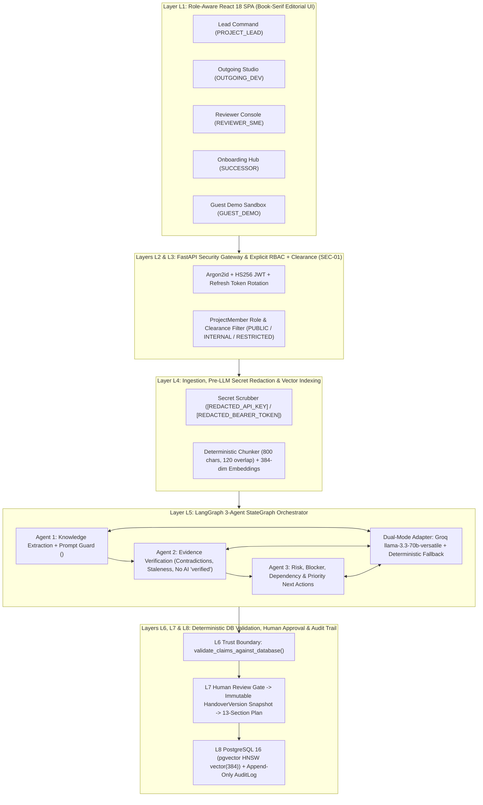

# Knowledge Handover — Final Hackathon Project Report (Continuity OS v2.1)

> **Core Paradigm:** *"Evidence before assertion; uncertainty shown, never hidden; nothing shared before human approval."*

- **Project Title:** Knowledge Handover — Agentic, Evidence-Linked, Human-Approved Software Continuity Platform
- **Team Members:**
  1. **Preeti Satish Mittal** — Team Leader, AI Multi-Agent Architecture, RAG & Backend Security Lead
  2. **Ankit Madanlal Chaudhari** — Frontend Architecture, Role-Aware Product Workflow & UX Lead
- **Live Cloud Deployment:**
  - **Backend API (Render):** `https://kh-backend-z2o3.onrender.com` (`/docs`, `/api/v1/health`)
  - **Frontend Web App (Render):** `https://kh-frontend.onrender.com`
  - **GitHub Repository:** `https://github.com/Ankit592006/Knowledge-handover.git`

---

## 1. Executive Summary & Problem Statement

When a senior software engineer, architect, or technical lead departs a project or transitions between teams, organizations suffer severe **tacit knowledge evaporation**. Critical architectural rationale, undocumented operational workarounds, in-flight blockers, and cross-team dependencies remain scattered across fragmented repositories: Architecture Decision Records (ADRs), pull requests, issue trackers, sprint sync notes, and commit logs.

Existing approaches to engineering handovers fail in four predictable ways:
1. **Manual Handover Checklists Are Incomplete & Stale:** Outgoing engineers under transition deadline pressure write high-level summaries that omit operational edge cases (such as manual Redis cache flushes before settlement database migrations) or reference deprecated API endpoints.
2. **Generic LLM Summarizers Hallucinate & Hide Contradictions:** Standard RAG/chat tools blend old and new documents into fluent prose. When a June specification prescribes `POST /v1/payments/charge` and an October pull request (`PR-218`) replaces it with `POST /v2/payment-intents`, generic LLMs silently merge or guess between them—misleading the incoming successor.
3. **Unassigned Ownership & Missing Rationale Are Fabricated:** Standard generative models fill gaps with plausible-sounding owners or deadlines rather than explicitly flagging that an issue has `Assignee: UNASSIGNED` or an undecided retry policy.
4. **Security, Secret Leakage & Clearance Violations:** Raw commit notes and hotfix logs frequently contain live API keys, Bearer tokens, database credentials, or `RESTRICTED` vendor audit findings that must never be sent to external LLM APIs or exposed to unauthorized roles.

### Our Solution: Knowledge Handover
**Knowledge Handover** transforms raw, fragmented engineering artifacts into an **evidence-linked, contradiction-aware, human-approved 13-Section Continuation Plan**. Every extracted claim is bound to a character-level citation (`sourceId`, `body#chars:start-end`, `versionTag`, `sourceUpdatedAt`), validated by a deterministic backend trust boundary (Layer L6), and locked behind a role-enforced Human Approval Gate before the incoming successor can access or acknowledge the handover package.

---

## 2. Six Core Architectural Differentiators

| # | Differentiator | How It Works in Knowledge Handover |
| :-: | :--- | :--- |
| **1** | **Zero Silent Fabrication (Strict Provenance)** | Every extracted claim must link to >= 1 verified source excerpt. Layer L6 (`validate_claims_against_database`) verifies every cited `source_id` against the database, strips invalid/unauthorized citations, and downgrades unsupported claims to `unknown`. |
| **2** | **Contradiction & Staleness Surfacing** | When sources disagree (e.g., `issue-104` reports `BLOCKED` on Nov 6 while `notes-2026-10-15` reports `IN PROGRESS` on Oct 15), Agent 2 preserves both excerpts side-by-side with timestamps and labels the claim `conflicting` or `potentially_outdated`. |
| **3** | **Never Invents Owners or Rationale** | Missing decision rationale (`adr-001` webhook retry backoff policy) and unassigned owners (`issue-104`) remain explicitly `null` and automatically generate targeted Clarification Questions for the outgoing developer. |
| **4** | **Pre-LLM Secret Scrubbing & Prompt Guard** | Regex redaction (`app/modules/ingestion/redaction.py`) scrubs API keys, Bearer tokens, DB URLs, and private keys before storage or LLM calls, while `sanitize_untrusted_passage` isolates embedded prompt-injection attacks (`[ADVERSARIAL_INSTRUCTION_ISOLATED]`). |
| **5** | **AI Schema-Prohibited from Marking `verified`** | Pydantic field validators on Agent 2 and the L6 backend gate strictly forbid AI from outputting `status="verified"`. Only an authenticated human `REVIEWER_SME` or `PROJECT_LEAD` can mark claims `verified`. |
| **6** | **Approval-Gated 13-Section Successor Plan** | The Incoming Successor is blocked at the API level (`HTTP 403`) from viewing the Continuation Plan until human approval freezes an immutable `HandoverVersion` snapshot. Exclusively the `SUCCESSOR` role can formally acknowledge receipt. |

---

## 3. End-to-End 8-Layer System Architecture

---

## 4. Deep Dive: The 3-Agent LangGraph Pipeline & Dual-Mode LLM Adapter

### 4.1 Orchestration & Stop-on-Failure Guarantees
Implemented in `backend/app/agents/orchestrator/workflow.py`, `execute_handover_orchestration()` compiles a `langgraph.graph.StateGraph` over `HandoverGraphState`:
1. **Node 1 (`node_knowledge_extraction`)**: Calls **Agent 1**. Wraps every passage in `<untrusted_evidence source_id='...'>` after running `sanitize_untrusted_passage()`. Extracts structured `CandidateClaimSchema` objects across 8 claim types (`project_overview`, `technical_context`, `key_decision`, `completed_work`, `active_work`, `blocked_work`, `responsibility`, `operational_info`) and outputs `UnresolvedQuestionSchema` clarifications.
2. **Node 2 (`node_evidence_verification`)**: Calls **Agent 2**. Cross-checks candidate claims against source passages and `source_updated_at` timestamps. Outputs `ClaimVerificationResultSchema` with `ConflictRecordSchema` pairs for contradictory statuses (`issue-104` vs `notes-2026-10-15`) and stale documentation (`doc-legacy-api` vs `pr-218`). Enforces `@field_validator("evidence_status")` prohibiting AI from returning `"verified"`.
3. **Node 3 (`node_risk_dependency`)**: Calls **Agent 3**. Synthesizes `CandidateRiskDependencySchema` (`blocker`, `risk`, `dependency`) and priority-ranked `CandidateNextActionSchema` onboarding steps linked to claim codes.

If any agent node fails after `LLM_MAX_RETRIES=2`, conditional routing (`_route_after_node`) halts the graph immediately, sets `handover.status = "failed"`, logs `HANDOVER_RECONSTRUCTION_HALTED`, and returns `HTTP 503` so partial or unverified AI output is never published.

### 4.2 Dual-Mode OpenAI-Compatible (Groq) + Deterministic Extractive Adapter
In `backend/app/agents/adapter/llm_adapter.py`, `invoke_structured_model()` supports:
- **`LLM_PROVIDER="openai_compatible"` (Production Default on Render)**: Calls Groq (`https://api.groq.com/openai/v1/chat/completions`) with `llama-3.3-70b-versatile`, `temperature=0.0`, `response_format={"type": "json_object"}`, and strict Pydantic JSON Schema validation.
- **`LLM_PROVIDER="ollama"`**: Connects to local Ollama (`qwen2.5:7b-instruct`).
- **Automatic Deterministic Extractive Fallback (`rule-grounded-extractor-v1`)**: If the cloud LLM is unreachable, rate-limited, or unconfigured in CI tests, the adapter seamlessly executes the deterministic rule-grounded extractor and records `provider_used`, `live_llm_invoked`, `latency_ms`, and `fallback_reason` in `agentTelemetry`.

---

## 5. Security Architecture: 5-Role RBAC Matrix & Classification Clearance (`SEC-01`)

| Project Role | Demo Persona Identity | Clearance Scope | Permitted Actions & Visible UI Workspace |
| :--- | :--- | :--- | :--- |
| **`PROJECT_LEAD`** | **Preeti Mittal** (`preeti.lead@payflow.demo`) | `PUBLIC`, `INTERNAL`, `RESTRICTED` | Full governance: sees all 8 sources (including `restricted-vendor-note`), uploads sources, runs 3-agent reconstruction, answers clarifications, verifies claims, approves package, views Audit Trail & Successor Plan. |
| **`OUTGOING_DEV`** | **Arjun Mehta** (`arjun.outgoing@payflow.demo`) | `PUBLIC`, `INTERNAL` | Outgoing Studio: uploads project sources, runs reconstruction, answers open Clarification Questions, flags/annotates claims. **Cannot** mark claims `verified` or approve the handover package. |
| **`REVIEWER_SME`** | **Kavita Rao** (`kavita.reviewer@payflow.demo`) | `PUBLIC`, `INTERNAL` | Reviewer Console: inspects source evidence, marks claims `verified`, `needs_clarification`, or `rejected`, formally approves the handover package (freezing snapshot `vN`), and inspects Audit Trail. |
| **`SUCCESSOR`** | **Ankit Chaudhari** (`ankit.successor@payflow.demo`) | `PUBLIC`, `INTERNAL` | Onboarding Hub: blocked from viewing unapproved drafts (`HTTP 403`). Once approved, unlocks the 13-Section Continuation Plan, exports Markdown/JSON, and holds **exclusive permission** to Acknowledge Handover Receipt. |
| **`GUEST_DEMO`** | **Anonymous Evaluator** (Read-Only) | `PUBLIC`, `INTERNAL` | Incognito evaluator mode scoped strictly to synthetic `payflow` demo project. Navigation restricted to Overview, Dashboard, and Permitted Sources (7 non-restricted sources). Zero write/review/approval access. |

---

## 6. Complete Traceability Against Round 1 Solution Proposal

### 6.1 Functional Requirements (FR-01 to FR-11 — 100% Completed)

| Req ID | Round 1 Proposal Requirement | Priority | Status | Implementation & Code Evidence |
| :--- | :--- | :---: | :---: | :--- |
| **FR-01** | **Scoped Source Ingestion** with classification tags (`PUBLIC`, `INTERNAL`, `RESTRICTED`) | Must Have | **Completed** | `POST /api/v1/projects/{id}/sources/upload` & `POST /api/handovers/{id}/sources/import`; chunking (`800` chars, `120` overlap) and 384-dim embeddings in `app/modules/ingestion/service.py`. |
| **FR-02** | **Structured Claim & Decision Extraction** across 8 engineering categories | Must Have | **Completed** | Agent 1 (`app/agents/knowledge_extraction/agent.py`) extracts `CandidateClaimSchema` items with rationale, owner, task status, confidence, and evidence pointers. |
| **FR-03** | **Mandatory Evidence Attribution** (`sourceId`, `location`, `excerpt`, `versionTag`) | Must Have | **Completed** | Independently verified by Layer L6 (`validate_claims_against_database`) and persisted in `claim_evidence_links` with exact character offsets. |
| **FR-04** | **Cross-Artifact Contradiction Detection** (preserving both conflicting sources side-by-side) | Must Have | **Completed** | Agent 2 detects status mismatch between `issue-104` (`BLOCKED`, Nov 6) and `notes-2026-10-15` (`IN PROGRESS`, Oct 15) and attaches both in `ConflictRecordSchema`. |
| **FR-05** | **6-State Evidence Status Vocabulary & Confidence Scoring** | Must Have | **Completed** | Implements `source_supported`, `conflicting`, `potentially_outdated`, `inferred`, `unknown`, and human-only `verified` (`EvidenceStatusBadge.tsx`). |
| **FR-06** | **Targeted Clarification Prompting & Dynamic Claim Enrichment** | Must Have | **Completed** | Auto-generates open questions for undecided ADR retry policies, unassigned owners, and missing runbooks; answering via `POST /api/handovers/{id}/clarifications/{qid}` updates linked claims. |
| **FR-07** | **Interactive Evidence Inspector Modal** (verbatim excerpts & conflict comparison) | Must Have | **Completed** | Implemented in `EvidenceInspectorModal.tsx` with character anchors, deterministic verification badges, and side-by-side conflict diffs. |
| **FR-08** | **Human Review & Approval Gate** (freezing immutable version snapshots) | Must Have | **Completed** | `PATCH /api/claims/{id}` and `POST /api/handovers/{id}/approve` freeze an immutable `HandoverVersion` record and log `HANDOVER_APPROVED`. |
| **FR-09** | **Approval-Gated 13-Section Successor Continuation Plan** | Must Have | **Completed** | `GET /api/handovers/{id}/successor-view` enforces `HTTP 403` until approved, then renders all 13 structured onboarding sections. |
| **FR-10** | **Pre-Indexing Secret Redaction & Adversarial Prompt-Injection Guard** | Must Have | **Completed** | Scrubs live secrets (`[REDACTED_API_KEY]`, `[REDACTED_BEARER_TOKEN]`) before storage/LLM calls and neutralizes embedded prompt overrides (`[ADVERSARIAL_INSTRUCTION_ISOLATED]`). |
| **FR-11** | **Self-Contained Handover Package Export** (Markdown & JSON) | Should Have | **Completed** | `GET /api/v1/handovers/{id}/export?format_type=markdown\|json` generates portable archival reports with inline citations. |

### 6.2 Non-Functional Requirements (NFR-1 to NFR-7 — 100% Completed)

| NFR ID | Proposal Requirement | Target Metric | Implemented Mechanism |
| :--- | :--- | :--- | :--- |
| **NFR-1** | **Latency & Responsiveness** | Reconstruction `< 30s`; UI reads `< 300ms` | Sub-second deterministic execution (`< 50ms`) or `< 8s` live Groq `llama-3.3-70b-versatile` inference with millisecond per-agent telemetry. |
| **NFR-2** | **Determinism & Structured Output** | 100% schema-validated JSON | Strict Pydantic v2 schemas (`app/agents/schemas.py`) + `temperature=0.0` for all agent calls. |
| **NFR-3** | **Zero Silent Fabrication** | 0 uncited claims presented as fact | Layer L6 strips non-existent/unauthorized `source_id` citations and downgrades uncited claims to `unknown`. |
| **NFR-4** | **Security & Access Control** | Pre-LLM secret scrubbing + RBAC | Regex redaction runs before DB storage and LLM calls; `SEC-01` clearance filters every RAG query. |
| **NFR-5** | **Auditability & Versioning** | Immutable version snapshots + logs | `HandoverVersion` stores frozen JSON packages (`v1`, `v2`, ...); `AuditLog` records every state transition. |
| **NFR-6** | **Reliability & Graceful Degradation** | Deterministic fallback on LLM timeout | Dual-mode adapter automatically falls back to `rule-grounded-extractor-v1` if cloud LLM is unreachable. |
| **NFR-7** | **Usability** | `<= 2` clicks from claim to source excerpt | Clicking any claim card immediately opens `EvidenceInspectorModal` with verbatim source excerpts and character offsets. |

---

## 7. The 13-Section Approval-Gated Successor Continuation Plan

Once approved by a `REVIEWER_SME` or `PROJECT_LEAD`, the platform unlocks all **13 structured sections** for the incoming `SUCCESSOR`:
1. **01 · Project Overview & Service Charter** — Core architecture summary and payment orchestration scope.
2. **02 · Technical Context & Active API Surface** — Active `POST /v2/payment-intents` flow vs. deprecated v1 endpoints.
3. **03 · Key Architectural Decisions & Rationale** — Approved ADRs (`adr-001`) plus explicit notes on undecided retry parameters.
4. **04 · Completed Milestones & Delivered Work** — Verified completed deliverables (Stripe v2 adapter, PostgreSQL idempotency ledger).
5. **05 · Active & Blocked Work Items** — In-flight tasks and blocked work (`issue-104` 3DS2 callback timeout handler).
6. **06 · Ownership Transfer & On-Call Responsibilities** — Departing role charter, transferred claim ownership, and key contacts (`@priya.nair`).
7. **07 · Operational Runbooks & Deployment Workarounds** — Critical pre-migration steps (manual Redis `payflow:idem:*` flush during traffic drain).
8. **08 · Risks, Blockers & Cross-Team Dependencies** — High/medium/low risk cards with source/target entities and workarounds.
9. **09 · Contradictions & Potentially Outdated Records** — Side-by-side audit of conflicting timestamps and superseded documentation.
10. **10 · Clarification Q&A Log (Outgoing Developer Responses)** — Complete log of AI questions and human answers from the departing engineer.
11. **11 · Prioritised Next Actions (Day-1 Onboarding Plan)** — Rank-ordered action checklist linked to evidence claim codes.
12. **12 · Authorised Source Inventory & Redaction Summary** — Permitted source manifest with classification tags and secret redaction counts.
13. **13 · Human Approval & Successor Receipt Sign-Off** — Immutable approval signature, version number, and successor receipt acknowledgement.

---

## 8. Ten Extra Production Features Built Beyond the Round 1 Proposal

1. **Genuine 4-Persona Backend Role Switcher (`POST /api/v1/demo/switch-role`)**: Issues real database-backed HS256 JWTs for `PROJECT_LEAD`, `OUTGOING_DEV`, `REVIEWER_SME`, and `SUCCESSOR`.
2. **One-Click Live Demo Reset (`POST /api/v1/demo/bootstrap-payflow?reset=true`)**: Resets PayFlow back to a clean `v1` unapproved draft while preserving the append-only audit trail.
3. **3-Tier Classification Clearance Enforcement (`PUBLIC`, `INTERNAL`, `RESTRICTED`)**: `restricted-vendor-note` is visible to `PROJECT_LEAD` (8 sources) and automatically filtered out for all other roles (7 sources).
4. **Adversarial Prompt-Injection Isolation Engine**: Neutralizes embedded LLM override instructions (`[ADVERSARIAL_INSTRUCTION_ISOLATED]`) inside uploaded documents.
5. **Per-Agent Telemetry & Provenance Cards**: Displays latency (`ms`), attempt counts, active LLM provider (`openai_compatible_live` vs `deterministic_extractive`), and L6 validation statistics.
6. **Interactive 5-Step Lifecycle Progress Bar**: Tracks real-time progress across *01 Sources & Redaction* $\rightarrow$ *02 3-Agent Reconstruction* $\rightarrow$ *03 Clarifications & Review* $\rightarrow$ *04 Human Approval Gate* $\rightarrow$ *05 Successor Receipt*.
7. **Append-Only Governance Audit Trail Explorer**: Dedicated UI tab allowing Project Leads and Reviewers to inspect every state mutation, actor email, role context, and JSON payload diff.
8. **Book-Professional Editorial Typography System**: Pairs *Libre Baskerville* headings, optical-sized *Source Serif 4* body prose, and *JetBrains Mono* citations.
9. **Native PostgreSQL `pgvector` HNSW Indexing + Cross-Dialect SQLite Fallback**: Uses `vector_cosine_ops` HNSW indexes in production PostgreSQL while supporting zero-dependency SQLite execution for fast local/CI testing.
10. **Production Render Blueprint (`render.yaml`) & Multi-Stage Dockerfiles**: Full infrastructure-as-code deployment for `kh-postgres`, `kh-backend`, and `kh-frontend`.
